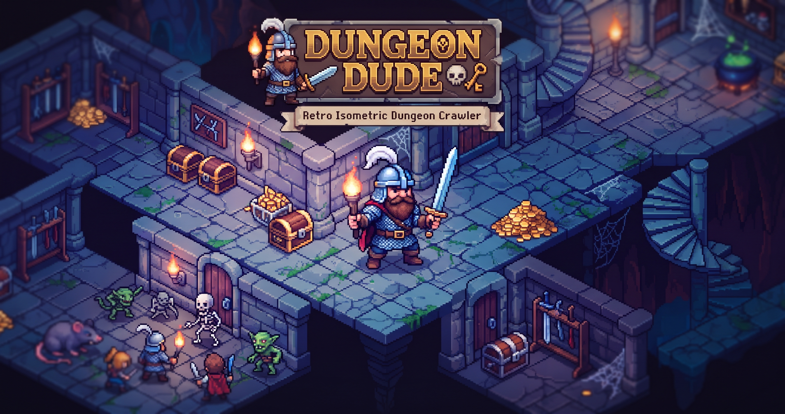

<p align="center">
  
</p>

<p align="center">
  
  
  
  
  
</p>

> **Dungeon Dude** is a self-playing, isometric 3D dungeon crawler. The dungeon is fully procedural, physically simulated, and rendered like a tabletop miniature. The hero is, for the record, *in post-production*.
>
> Think of it as Diablo, except instead of you being the hero, the hero is a guy we haven't written yet. The dungeon just waits. Patiently. Like a very patient cat.

<p align="center">
  
</p>

> *"Descend. The dungeon does not wait for you. It does not wait for the hero either. It just... keeps going."*
> — The Dungeon, probably

---

## Table of Contents

- [The Legend](#the-legend)
- [Quick Start (a.k.a. How to See the Thing)](#quick-startaka-how-to-see-the-thing)
- [The Stack (Yes, There Is One)](#the-stack-yes-there-is-one)
- [How the Dungeon Is Forged](#how-the-dungeon-is-forged)
- [Architecture Notes (the part where we explain why)](#architecture-notes-the-part-where-we-explain-why)
- [Environment Variables (the boring part, done properly)](#environment-variables-the-boring-part-done-properly)
- [Development Tools](#development-tools)
- [The Roadmap (what's real and what's promised)](#the-roadmap-whats-real-and-whats-promised)
- [Project Structure](#project-structure)
- [The Fine Print](#the-fine-print)

---

## The Legend

Dungeon Dude is a 3D isometric dungeon crawler built with React Three Fiber. It is designed to play itself: an ECS-driven hero autonomously explores procedurally generated floors, hunts monsters, and collects gold. Press WASD and you take over; go idle for four seconds and the AI takes right back.

The scene is rendered as a miniature diorama — a 20×20 tile dungeon on a stone pedestal, with tilt-shift, dither, film grain, and a vignette applied so it looks like a model someone built in a very patient afternoon.

**Current state:** the dungeon is generated, rendered, and collidable. The hero, the monsters, the UI, and the audio are next on the docket. The [Roadmap](#the-roadmap-whats-real-and-whats-promised) has the honest version.

---

## Quick Start (a.k.a. How to See the Thing)

Prerequisites: Node 18+ and a browser with WebGL.

```bash
npm install
npm run dev
```

Open the local URL Vite prints. You should see a freshly generated dungeon on its pedestal, diorama effects and all.

| Command | What it does |
|---|---|
| `npm run dev` | Start the dev server (includes the development overlay) |
| `npm run build` | Type-check with `tsc -b`, then build for production |
| `npm run preview` | Serve the production build locally |
| `npm run lint` | Run ESLint |

The game is configured to talk to a local XTTS v2 server for voice lines (Step 8). That server is optional; the game runs fine without it.

---

<p align="center"></p>

## The Stack (Yes, There Is One)

| Layer | Choice |
|---|---|
| Core | React 19 (with the React Compiler), TypeScript, Vite 5 |
| Rendering | three.js, React Three Fiber, React Three Drei |
| Physics | @react-three/rapier, fixed 60 Hz timestep |
| Game state | miniplex (ECS) for per-frame data, Zustand for UI state |
| Post-processing | @react-three/postprocessing: tilt-shift, dither, noise, vignette |
| Audio | Howler.js plus a local XTTS v2 server (Step 8) |
| Styles | SCSS Modules with a shared variables partial |

---

## How the Dungeon Is Forged

Every run is generated from a fresh random seed, and every floor in that run derives from it, so a reported layout can still be reproduced exactly:

1. **Seed.** A new 32-bit seed is rolled when the page loads and again whenever a run starts or restarts. Depth one uses the run seed; deeper floors hash the run seed with the depth. A `VITE_DUNGEON_SEED` override wins over both for debugging.
2. **Rooms.** Sixteen to twenty-two rooms are placed on the 48×48 grid with a two-tile gap. The start room is 8×8 to 11×11, centered on the spawn point; the others are 4×4 to 8×8.
3. **Corridors.** Two-tile-wide corridors are stamped between rooms with obstacle awareness, and a flood-fill check guarantees every room is reachable.
4. **Walls.** Full-height walls (2.2 units) sit on the far edges of the diorama; low ledges (0.6) sit everywhere else so the fixed isometric camera can see into corridors. Adjacent wall tiles are merged into runs, so one collider replaces many.
5. **Dressing.** Seeded room themes add landmarks (shrines, treasuries, prisons, collapsed halls, gardens, barracks), wall sconces and banners, moss, puddles, cracks, rubble, barrels, crates, bones, and glowing mushrooms. Props are cosmetic only; collision still comes from the floor grid.
6. **Layout.** The result is a single `DungeonLayout` object — rooms, floor cells, wall cells, merged wall runs, and the spawn point — cached by seed so re-renders never regenerate the floor.

Renderers and physics colliders read the same shared constants and the same `gridToWorld` transform, so what you see and what you collide with cannot drift apart.

---

## Architecture Notes (the part where we explain why)

- **The ECS owns the game, not React.** Positions, velocities, and health live in a miniplex world at module scope so per-frame data never triggers a React render. Zustand holds UI-level state only — depth, gold, monsters slain, autoplay, and the debug flags. It is safe to subscribe to from the HUD.
- **Physics is Rapier, always.** Fixed `1/60` timestep, standard gravity, no hand-rolled collision math.
- **The React Compiler is enabled** (`babel-plugin-react-compiler`, targeting React 19). That is why the Vite config uses the Babel-based React plugin rather than the SWC one.
- **The diorama look is a pipeline, not a texture.** Tilt-shift blurs first so the dither pattern stays crisp, grain adds analog texture, and the vignette frames the diorama last.
- **Small files are a rule, not a vibe.** Components stay under 200 lines, game logic lives in hooks and systems, and `.tsx` files render meshes.
- **The `@` alias maps to `src/`**, and SCSS variables are injected into every module automatically.

---

<p align="center"></p>

## Environment Variables (the boring part, done properly)

| Variable | Default | Purpose |
|---|---|---|
| `VITE_TTS_API_URL` | `http://localhost:5002/api/tts` | Local XTTS v2 endpoint (Step 8) |
| `VITE_TTS_VOICE_MODEL` | `deckard_cain` | Voice model name for the TTS server |
| `VITE_DEBUG_PHYSICS` | `false` | Show Rapier wireframes on startup |
| `VITE_STARTING_LEVEL` | `1` | Depth the game starts at |
| `VITE_DUNGEON_SEED` | *(unset)* | Pin one specific layout; set it before Vite starts |

## Development Tools

Development builds only: a **Dev** button opens a panel showing the current depth, seed, room count, floor cell count, and wall run count, with toggles for frame stats and physics collider wireframes. The overlay disappears entirely from production builds.

Two things to know:

- The physics toggle flips a Zustand value that the physics layer reads, so wireframes appear without a reload.
- The seed override is read once at module load. Set `VITE_DUNGEON_SEED` before `npm run dev`, not while it is running.

---

## The Roadmap (what's real and what's promised)

| Step | Scope | Status |
|---|---|---|
| 1 | App scaffold and isometric base scene | ✅ Done |
| 2 | Post-processing pipeline (the diorama look) | ✅ Done |
| 3 | ECS foundation and Rapier physics | ✅ Done |
| 4 | Procedural dungeon generation | 🔥 Code-complete, awaiting final browser acceptance |
| 5 | Hero, torch, autonomous AI, and manual WASD override | ⚔️ Next up |
| 6 | Monsters and combat | 🕯️ Planned |
| 7 | SCSS UI with View Transitions: menu, HUD, game over | 🕯️ Planned |
| 8 | Audio and local TTS (the Deckard Cain voice) | 🕯️ Planned |

The detailed micro-step checklist lives in `docs/steps/INDEX.md`; the running log of decisions lives in `AI_HANDOFF.md`.

## Project Structure

```
src/
├── App.tsx               # Composition root: Canvas, physics, dungeon, overlay
├── main.tsx              # Entry point
├── components/
│   ├── Effects.tsx       # The post-processing pipeline
│   ├── dungeon/          # Dungeon, floor, walls, plinth, collider
│   ├── effects/          # Custom dither effect
│   ├── physics/          # Rapier provider
│   ├── scene/            # Isometric camera and lighting
│   └── debug/            # Dev-only overlay and frame stats
├── game/
│   ├── constants.ts      # Shared world constants: tile size, timestep, gravity
│   ├── ecs.ts            # The miniplex world and entity factories
│   ├── store.ts          # Zustand UI state
│   └── dungeon/          # Seeded generation: rooms, corridors, walls, layout
├── styles/               # SCSS variables and globals
└── types/index.ts        # All shared TypeScript types
```

---

## The Fine Print

<details>
<summary><b>The part you scroll past (but should maybe read)</b></summary>

- **License:** This project does not include a license. Until one is added, the default copyright terms apply.
- **Seed 1337:** Yes, that's leet. No, we're not sorry.
- **The voice:** Step 8 wires the game to a local XTTS v2 server running a `deckard_cain` voice model. The dungeon is about to get a narrator. You're welcome.
- **The picture up top:** that's `public/og-image.png` — the same image social links use, doing double duty as the first photo the dungeon ever posed for.

</details>

<p align="center"></p>

<p align="center">
  <sub>Forged in React. Lit by a blood moon. Seed <b>1337</b>.</sub>
</p>
